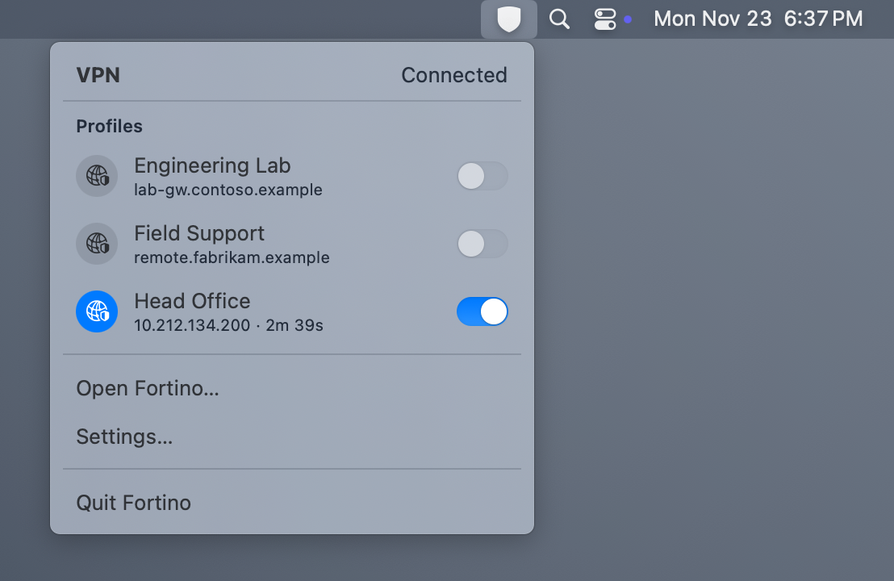

# Fortino

**The first open-source FortiClient alternative with EMS support.**

Connects to your company's FortiGate. Then gets out of your way.

<picture>
  <source media="(prefers-color-scheme: dark)" srcset="docs/assets/menu-dark.png">
  
</picture>

## Features

- **FortiClient EMS registration, one per profile.** Each VPN profile has its own EMS. Switching organizations takes one click, with no unregister and re-register ritual.
- **Password + OTP**, strict TLS, and an in-app review for pinning a gateway certificate.
- **Split routes and per-domain split DNS**, a DNS choice for each profile, and an IPv6 leak block.
- **Crash-safe networking.** Every route and DNS change goes into a journal first, so it gets rolled back even after a crash.
- **A sleek native menu-bar app** (SwiftUI) **and a headless `fortino` CLI.**
- **Dark mode**, matching both your terminal and your mood about corporate VPNs.
- **You can quit it.** No icon squatting in your menu bar forever.
- **macOS Keychain** for saved passwords: coming soon.

## No backdoor, by design

FortiClient EMS can push remote commands (RUN_SRV_CMD), scripts, upgrades and forensic collection to the endpoints it manages. Fortino accepts none of them: those requests are refused and logged by name and nothing is uploaded to EMS.
Your VPN client shouldn't double as a remote shell.

Posture is truthful too. Fortino never reports an antivirus, a firewall or a host-check result it doesn't have, and it presents an EMS serial only after it has actually registered. Ask your IT team before registering it with a corporate EMS.

## Platforms

macOS on Apple silicon today. Want Linux or Intel? [Open an issue](https://github.com/moku-io/fortino/issues) and react with 👍

## Install

Download the DMG from [Releases](https://github.com/moku-io/fortino/releases), drag Fortino to Applications, open it and allow its VPN service once in System Settings → General → Login Items. To uninstall, drag it to the Trash.

Building from source? See [DEVELOPMENT.md](DEVELOPMENT.md): dev daemon, mock gateway, tests and the signed DMG.

## Docs

| | |
| --- | --- |
| [DEVELOPMENT.md](DEVELOPMENT.md) | Build, run and test locally |
| [docs/comparison.md](docs/comparison.md) | Fortino vs openfortivpn, OpenConnect and FortiClient |
| [docs/releasing.md](docs/releasing.md) | Signed DMG and release checklist |
| [CONTRIBUTING.md](CONTRIBUTING.md) | Contributing and licensing |
| [AGENTS.md](AGENTS.md) | Rules for coding agents |

## Sponsor

Fortino is brought to you by <a href="https://www.moku.io">Moku</a>, the makers of <a href="https://vaultlane.io">Vaultlane</a>. 
Need help with a VPN? <a href="https://www.moku.io/en/contact">Get in touch</a>.

## Thanks

Built on what [openfortivpn](https://github.com/adrienverge/openfortivpn), [OpenConnect](https://www.infradead.org/openconnect/fortinet.html) and their friends taught us. [Full credits](docs/comparison.md#thanks).

---

Copyright © 2026 Moku S.r.l. Licensed under [GPL-3.0-or-later](LICENSE).

Fortino is an independent project, not affiliated with or endorsed by Fortinet. FortiClient, FortiGate and FortiOS are trademarks of Fortinet, Inc.
